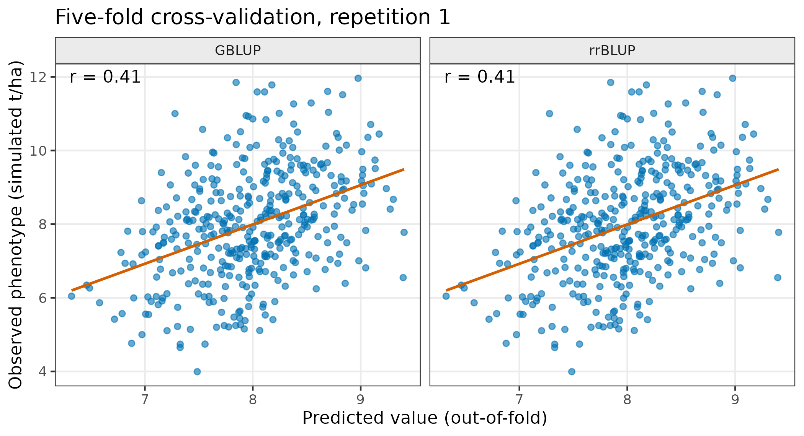
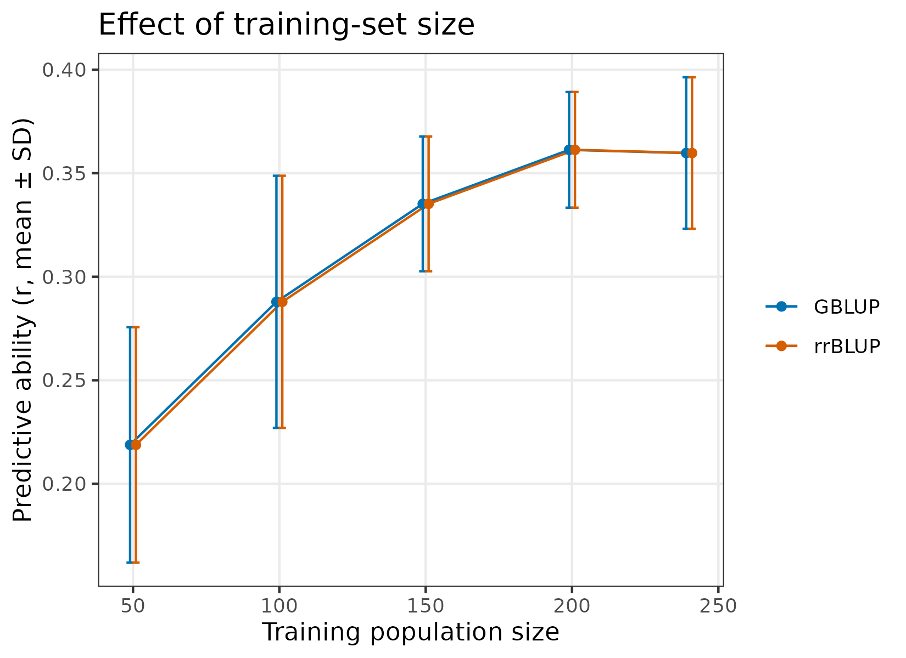
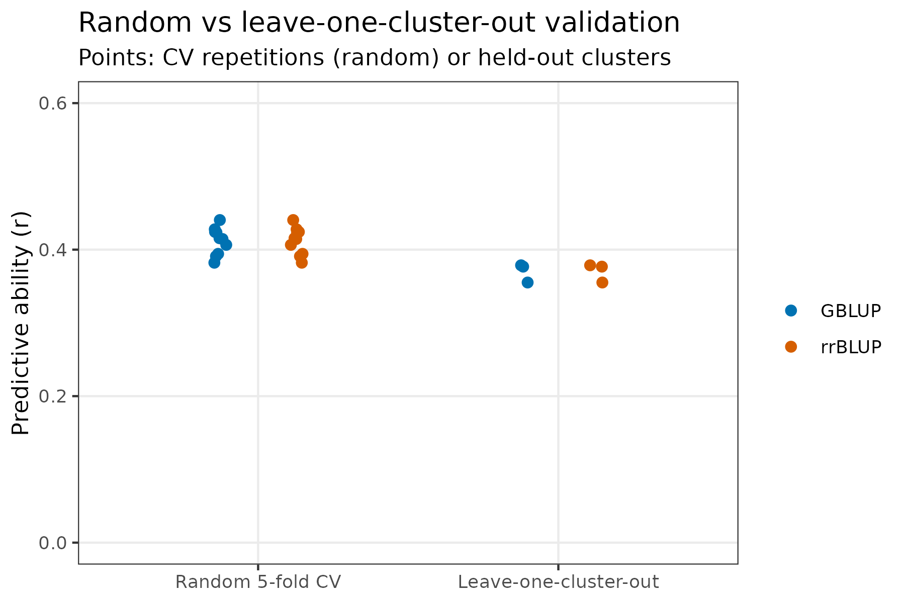

# Genomic Prediction with rrBLUP and GBLUP

A reproducible R workflow for genomic prediction of a quantitative trait from SNP markers:
genotype QC, VanRaden genomic relationship matrix, rrBLUP and GBLUP, and three
cross-validation designs, with publication-quality figures.

> **All data are simulated.** Results show that the code works and illustrate
> methodological points. They are **not** evidence of performance on real breeding data.

## Scientific question
How well can a grain-yield-like trait (simulated, h² = 0.5) be predicted from
~1,600 SNPs in a maize-like panel of 400 inbred lines, and how do prediction
accuracy and its interpretation depend on (i) training-population size and
(ii) the validation design?

## Methods
| Step | Method |
|---|---|
| Simulation | Three subpopulations (Balding-Nichols, F<sub>ST</sub> = 0.10); LD along 10 chromosomes via a Gaussian copula; 50 causal loci; 2% missing calls |
| QC | Remove SNPs with MAF < 0.05 or > 10% missing; lines with > 20% missing; mean imputation |
| Relationship matrix | VanRaden (2008) method 1, **G** = **ZZ**′ / 2Σp(1−p) |
| rrBLUP | Marker effects as random effects, REML (`rrBLUP::mixed.solve`) |
| GBLUP | Line effects with covariance **G**, REML (`rrBLUP::mixed.solve`, test phenotypes masked) |
| Validation | A) repeated random 5-fold CV (10 reps); B) accuracy vs training size (50–240 lines); C) leave-one-cluster-out (clusters inferred from marker PCA) |
| Metrics | Predictive ability *r* (cor. with observed phenotype); *r*<sub>TBV</sub> (cor. with simulated true breeding value, available only in simulation); RMSE; regression slope of observed on predicted |

**Model assumptions.** Additive genetic effects; single environment and trait; a single
variance component for marker effects (rrBLUP) / genetic effects (GBLUP); independent
normal residuals; entry-mean-like phenotypes without replication or fixed effects.

## Quick start
```bash
git clone https://github.com/YOUR-USERNAME/genomic-prediction-rrblup-gblup.git
cd genomic-prediction-rrblup-gblup
Rscript install_packages.R     # rrBLUP, ggplot2, scales, testthat
Rscript tests/run_tests.R      # unit tests (optional)
Rscript run_all.R              # full workflow (about 1-2 minutes)
```
Or run scripts individually from the repository root, in order: `R/01_...` to `R/06_...`.
Settings (seed, sample sizes, QC thresholds, CV design) are in `config.R`.

Tested with R 4.3.3, rrBLUP 4.6.x, ggplot2 3.x. The exact session is written to
`results/session_info.txt` after each run.

## Repository structure
```
├── config.R                 # all settings, incl. random seed
├── run_all.R                # runs the full pipeline
├── install_packages.R
├── R/
│   ├── functions.R          # simulation, QC, G matrix, models, metrics, plotting helpers
│   ├── 01_generate_data.R
│   ├── 02_qc_genotypes.R
│   ├── 03_genomic_relationship_matrix.R
│   ├── 04_fit_models.R
│   ├── 05_cross_validation.R
│   └── 06_visualize_results.R
├── data/                    # simulated inputs (see data/README.md)
├── results/{figures,tables}/
└── tests/                   # testthat unit tests
```

## Results from the included run (seed 2026)
| Validation design | Model | *r* (mean) | *r*<sub>TBV</sub> | RMSE (t/ha) |
|---|---|---|---|---|
| Random 5-fold, 10 reps | GBLUP / rrBLUP | 0.41 | 0.57 | 1.37 |
| Leave-one-cluster-out | GBLUP / rrBLUP | 0.37 | 0.50 | 1.44 |

Full tables are in `results/tables/` (`cv_summary.csv`, `cv_metrics_all.csv`).
The GBLUP genomic heritability estimate (0.36) is below the simulated value (0.5); this is
expected with ~400 lines and is a useful reminder that variance-component estimates are noisy at small *n*.





### Interpretation
- **rrBLUP and GBLUP give practically identical predictions.** With the same genotypes and
  a single variance component they are mathematically equivalent models; this is a built-in
  check, not a finding. Differences appear only with different kernels or priors
  (for example Bayesian models in BGLR), which this project does not include.
- **Accuracy rises with training size** and begins to plateau around 200 lines in this simulation.
- **Validation design matters.** Predicting a held-out genetic cluster gave lower accuracy
  than random CV. The gap here is modest because the simulated subpopulations are only
  moderately differentiated. In real breeding programmes, random CV can overstate
  accuracy for new families, cycles or environments, so match validation to the intended use.
- *r* is bounded by trait heritability; *r*<sub>TBV</sub> ≈ *r* / √h² (here 0.41 / 0.71 ≈ 0.57).

## Limitations
- Simulated data only; LD comes from a simplified copula model rather than a coalescent or real recombination.
- Causal loci are part of the marker set, which favours prediction relative to real data.
- Mean imputation, and QC/G computed on all lines before CV (no phenotypes are used, so this is not phenotype leakage, but a strict pipeline would recompute within folds).
- Single trait, single environment, additive model only (no dominance, epistasis, G×E).
- Clusters in design C come from k-means on PCs and are not independent breeding populations.

## Ideas for future versions
Add BGLR (BayesA/B/Cπ) and a non-additive kernel comparison; real public data with a clear
licence; family-aware and across-year validation; fixed effects for trial and block;
G×E extension (see the planned `multi-environment-genomic-prediction` repository); GitHub Actions to run tests.

## License and citation
MIT License (see `LICENSE`). Citation metadata in `CITATION.cff`.
Key references: VanRaden (2008) *J Dairy Sci* 91:4414; Endelman (2011) *Plant Genome* 4:250 (rrBLUP); Meuwissen et al. (2001) *Genetics* 157:1819.
